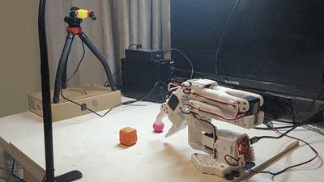

# SO-101 Lab

Experiments in affordable robotics and Physical AI, using the SO-101 robotic arm as an experimental platform.

This repository combines the project website, engineering documentation, experiment notes, and reusable hardware and software artifacts.

**Website:** https://koziev.github.io/so101-lab/ (available after GitHub Pages deployment)



## What you'll find here

- **Documentation** — assembly, 3D printing, electronics, setup, and calibration.
- **Experiments** — teleoperation, simulation, manipulation, and autonomy.
- **Blog** — chronological reports of experiments, observations, failures, and lessons learned.
- **Artifacts** — source code, robot descriptions, CAD exports, and configuration examples.

## Build the website locally

Python 3.10 or newer is recommended.

```bash
python -m venv .venv
source .venv/bin/activate
python -m pip install -r requirements.txt
mkdocs serve
```

Open http://127.0.0.1:8000.

## License

Unless otherwise stated, the original code, datasets, trained models, CAD and other research artifacts, and documentation in this repository are licensed under the **Creative Commons Attribution-NonCommercial 4.0 International License (CC BY-NC 4.0)**.

You are free to share and adapt these materials for any non-commercial purpose, provided that you give appropriate credit, link to the license, and indicate whether changes were made. Commercial use is not permitted without separate permission from the copyright holder.

Read the [CC BY-NC 4.0 license](https://creativecommons.org/licenses/by-nc/4.0/).

This license does not cover third-party materials, dependencies, or assets identified as being under separate terms. Those materials remain subject to their respective licenses.
