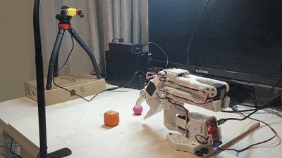

# Experiment 10: locating objects in the arm's joint space with Qwen3.5-0.8B

## Concept

Experiments v8 and v9 showed that a SmolVLA policy learns precise positioning only with a narrowly fixed camera, and that making it robust to camera displacement needs far more demonstrations than are practical. Experiment 10 separates the perception part of the problem: a small vision-language model looks at the stereo pair and a short description of the target ("blue ball") and answers where the object is, expressed directly in the arm's joint space:

```json
{"shoulder_pan": -10.3, "shoulder_lift": 19.0, "elbow_flex": 5.2, "wrist_flex": 65.5}
```

These are the angles (degrees, LeRobot convention, 0 = middle of the range) that place the gripper's grasp point at the centre of the target. No inverse kinematics is needed at run time, and each training sample is a single rendered image pair instead of a closed-loop demonstration.

**Label convention.** Wrist roll is fixed at 0 (the grasp point lies off the roll axis, so a free roll would move it), the grasp point is the one for a 30 mm object between the jaws, and the approach is as steep as reachable (vertical, else tilted 15/30/45° towards the base), as for the scripted expert of earlier experiments.

## Setup

- **Model:** Qwen3.5-0.8B (image-text-to-text, chat template), fully fine-tuned with `transformers.Trainer` in bf16 with gradient checkpointing; the loss covers only the JSON answer. Effective batch 16 on one RTX 3090. Practical requirement: the optimised kernels for the model's linear-attention layers (`flash-linear-attention`, `causal-conv1d`, compiled against a matching CUDA toolkit). Without them, training and inference were about 7 times slower.
- **Data:** the v9 simulator scene with 1–3 distractor objects of other colour/shape combinations, the arm in a random ready pose, stereo cameras drawn around the measured real camera pose with width factor *s*. One sample = rectified left and right images (640×360) + prompt + JSON answer, stored as Parquet. Optional synonyms in the training prompts ("box"/"block" for "cube", "grey" for "gray").
- **Evaluation:** greedy generation, JSON parsing, and the distance between the grasp point placed with the predicted angles and the object's centre. Simulated test sets at *T* = 0, 1, 2 (200 scenes each). Real test sets recorded with the arm itself: the stereo pair is captured with the arm in its ready pose; the operator then guides the jaws by hand onto the object, and the reference point is computed from the recorded joint angles.

## Results in simulation

| Model | Training data | *T* = 0 | *T* = 1 | *T* = 2 |
|---|---|---|---|---|
| smoke test | 3,000 samples, *s* = 1, 3 epochs | 1.36 cm (79 %) | 1.64 cm (65 %) | 2.24 cm (41 %) |
| v2 | 10,000 samples, *s* = 1.5, 2 epochs, new camera pose | **0.96 cm (94 %)** | **1.10 cm (86 %)** | **1.22 cm (78 %)** |

Median grasp-point error, with the share within 2 cm in brackets. All answers were valid JSON. The predictions track the true angles closely (correlation 0.93–0.98 for pan, lift and elbow), and the error grows only moderately with camera displacement: much less than the success of the v9 policies degraded under the same displacements.

## Results on the real arm

Getting from simulation to the real arm was the main part of the experiment, and most of the work went into finding and removing systematic geometric mismatches rather than into the model.

| Step | Real samples | Median error | Within 2 / 3 cm |
|---|---|---|---|
| smoke-test model, first real set (scene reassembled) | 50 | 3.9 cm | 4 / 26 % |
| v2 model, new real set, no corrections | 101 | 4.54 cm | 6 / 15 % |
| shoulder_pan zero corrected (6.5°) | 101 | 4.16 cm | 14 / 24 % |
| constant offsets of four joints, cross-validated on halves of the set | 2 × 40 | 1.4–1.7 cm | 62–72 % within 2 cm |
| **same offsets, applied to a newly recorded set** | **74** | **1.88 cm** | **58 / 91 %** |

What was found along the way:

1. **Camera pose.** After the scene was reassembled, the real camera no longer matched the simulated one. Re-measuring it with a checkerboard showed that it had moved 7.5 cm back and tilted 5° further down, which put the robot's base and the ready-pose gripper outside the image. The camera was re-aimed in two iterations until those reference points were in view (57.3 cm from the pan axis, 31.9 cm high, 37.7° down). The simulator was also corrected: the measured pose describes the left eye, while the simulator had placed the stereo centre there. A reference image of the empty board now allows the camera to be realigned after any disturbance (feature matching reports the remaining shift and rotation).
2. **Workspace coverage.** 15 of 101 real targets lay outside the ±30° sector used in training; the model never predicted beyond its training range (median error 6.0 cm there, against 4.2 cm inside).
3. **Joint zero offsets.** Inside the sector, the predicted shoulder_pan was consistently 5.5° ± 3.5° too high. Pointing the real arm straight along the board's centre line read −6.5° instead of 0°: LeRobot's calibration had set the joint's zero a few degrees off. Correcting it removed the sideways bias but left errors along the reach and in height. Fitting constant offsets for all four joints on one half of the real samples and testing on the other half cut the error from 3.4–3.9 cm to 1.4–1.7 cm. The fitted wrist_flex offset (about +9°) was consistent between halves; lift and elbow partly substitute for each other and were less well determined. Fitted offsets absorb any constant geometric error, not only calibration zeros.
4. **Independent confirmation.** With the offsets fitted on the earlier set, a newly recorded set of 74 samples gave a median of 1.88 cm, 91 % within 3 cm and no wrong-object errors (single objects 1.7 cm, pairs 1.9 cm). Same-colour pairs (red cube + red ball) were not harder than other arrangements: the model reads the shape word.

The remaining gap to simulation (1.9 vs 1.0 cm) includes the noise of hand-guided reference points, estimated at about half a centimetre.

## Closing the loop: scripted grasps

A scripted grasp (pre-grasp 6 cm above the predicted centre, descent, close, lift) driven by the model's prediction:

| Test | Result |
|---|---|
| pointing 2 cm above the predicted centre | median estimated miss 1.2 cm (12 trials) |
| grasp, first version | 7 / 22 |
| grasp, with execution changes | **11 / 21** |

The execution changes concerned the gripper, not the model: planning the jaws for a 42 mm object (more clearance between the fixed jaw and the predicted centre), opening wider, a slow final descent, and a pause after closing before lifting. The gripper itself needed fixing too: the gripper command was clipped by the controller's step limit, so the jaws kept closing while the arm was already lifting. Remaining failure modes: the fixed jaw touching and pushing large cubes when the aim errs towards it, and balls slipping out of the smooth PLA jaws.



## Conclusions

1. **Qwen3.5-0.8B works as an object-localisation model in joint space.** In simulation it reaches about 1 cm median error at the calibrated camera pose, with valid JSON in every answer, and it is considerably more robust to camera displacement than the end-to-end policies of v8/v9.
2. **Training only on simulated images transfers to real images, with moderate degradation:** 1.9 cm median on real images against 1.0 cm in simulation, once the geometry of the real setup matches the simulator.
3. **Matching the real setup to the simulator was the hardest part.** Camera pose, the left-eye/stereo-centre convention, the arm's joint zero offsets and the gripper's control behaviour each produced systematic errors of several centimetres. They were found one by one, and each needed its own measurement or correction. Without them, the real error was 4.5 cm and grasps failed.
4. **Turning 2 cm of localisation into reliable grasps needs more than localisation:** about half of the scripted grasps succeeded, limited by the gripper's geometry (one fixed jaw), object shape and friction.

## Next steps

- **Arm state as input, and iterative correction.** Show the arm in random poses in the training images and put its current joint angles into the prompt, so that the model can use the visible gripper as a reference ("the object is a bit beyond and left of the gripper"). Then repeat the prediction while approaching. That should reduce both the remaining real error and the sensitivity to camera displacement, in the spirit of visual servoing.
- **Automatic calibration.** Replace manual measurements by a marker on the gripper: the arm moves through a set of poses and the camera pose (and joint offsets) are estimated automatically, repeatable after every disturbance.
- **Workspace and object coverage.** Widen the trained sector to the area actually used (about ±45°) and predict the wrist roll from the object's orientation for cubes.
- **Scale and robustness.** More samples and wider camera randomisation are cheap in this formulation and directly test how far robustness to camera displacement can be pushed by data. A real fine-tuning set is also cheap: real labels need only a hand-guided pose per sample.
- **Output head.** Numbers generated as text are trained with a token-level loss; a regression head on the model's hidden states would be a useful comparison if precision plateaus.
- **Integration.** Use the predicted target as an explicit input to a grasping policy, or as the interface between a planner and a grasp skill.
- **Hardware.** Rubber pads on the jaws for balls; the 12 V arm with its own offsets; the 2.8 mm and 2.1 mm lenses for a wider view.

## Research artefacts

- **Code:** [`experiments/exp10/`](https://github.com/Koziev/so101-lab/tree/main/experiments/exp10) — simulator, training, evaluation, camera calibration, real-arm data collection and grasping utilities.
