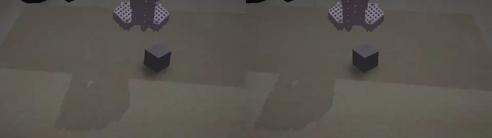
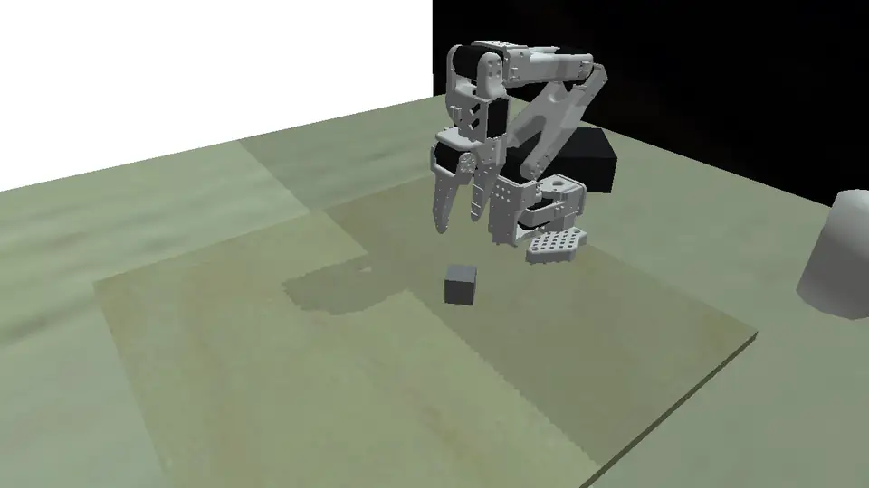

# The PyBullet simulator behind experiments 1–10

All policies and models in this log so far were trained on data from one simulator, built on PyBullet around the SO-101 arm. Before trying a different simulation platform, this entry documents what the simulator does, how it evolved, and what working with PyBullet was like: what it made easy and where it got in the way.

## What it simulates

The arm is the official SO-101 model (`so101_new_calib.urdf` from TheRobotStudio), with one important change: the gripper jaws' collision shapes were replaced by convex decompositions. PyBullet treats each mesh as a single convex hull by default, which closes the gap between the jaws and makes grasping physically impossible. With the decomposed jaws, grasps are fully physical: position-controlled joints with torque limits, gravity, and friction between jaws and object decide whether an object is held. Grasp poses are planned with inverse kinematics on the model's own kinematic chain. A scripted expert executes approach, descent, closing and lift; it can perturb its own motion to produce recovery demonstrations, and lifts as soon as the gripper is blocked by the object.

The scene grew in steps alongside the experiments:

- **v1–v6:** a plain table, coloured cubes and balls, a front and a wrist camera. Enough to train the first SmolVLA policies to 90 % in simulation.
- **v7:** a model of the real setup: a 50×49 cm plywood board on a desk, textures made from photographs of the actual board, desk and room, background clutter, and a stereo camera with the geometry of the real rectified USB stereo camera. Rendered images pass through a noise model fitted to the real camera (white balance, exposure, vignetting, blur, sensor noise, JPEG compression).
- **v8–v9:** randomised stereo camera poses around the measured real camera, rejection of camera poses that cannot see the robot base, the gripper and the work area, and a model of the real 7.4 V servos: a direction-dependent dead band measured on the arm (shoulder and elbow stop 2–4.5° short against gravity) and a command delay of 0–2 control steps.

<video controls preload="metadata" style="width: 100%;">
  <source src="/so101-lab/assets/simulator/pybullet/grasp.mp4" type="video/mp4">
  Your browser does not support the video element.
</video>

## What made PyBullet a good choice

- **Installation and integration are trivial.** `pip install pybullet`, no GPU, no display, no licence, no separate application. The simulator is an ordinary Python package; scripts, data generation and evaluation all import it directly.
- **It runs anywhere, headless and in parallel.** Rendering uses PyBullet's CPU renderer, so generation scales with CPU cores: six worker processes generated 2,000 grasp episodes (stereo pair at 30 fps, several hundred frames each) in about 12–14 hours, and the single-image samples of experiment 10 at roughly half a second each. The GPU stays free for training.
- **Every episode is reproducible from its seed.** Scenes, cameras, objects and noise are all drawn from one seeded generator, which made paired comparisons between models (the same 100 scenes for every policy) possible throughout the log.
- **The physics is good enough for tabletop grasping,** once the gripper's collision geometry is right. Rigid-body contact, friction and joint limits behave plausibly; failure modes seen in simulation (pushing an object away, closing beside it) also appeared on the real arm.

## Where it got in the way

- **Rendering realism.** The CPU renderer draws simple diffuse shading with a single directional light: no global illumination, no reflections, no physically based materials, no anti-aliasing. Photo textures and the camera noise model help, but simulated images remain recognisably synthetic, and the policy's reaction to real images was noticeably weaker than to simulated ones.
- **Shadows needed workarounds.** The renderer's shadow map was too coarse for 2–4 cm objects: with a 1 cm near clipping plane, small objects cast no shadow at all, and the noise model washed out what remained of the dithered shadows. Object shadows are now computed geometrically and drawn onto the board.
- **CPU rendering is slow at higher resolutions.** A stereo pair at 640×360 per eye takes a large fraction of a second. Experiments that need many rendered frames (closed-loop demonstrations, evaluation runs over hundreds of scenes) take hours to days. The OpenGL renderer is faster but needs a display or an EGL setup and renders differently.
- **Rigid bodies only.** The real test objects were hand-formed plasticine, soft and irregular; the simulator knows only rigid primitives. Contact parameters (friction, restitution) had to be tuned by hand.
- **Everything beyond rigid-body physics is hand-made.** Servo behaviour, camera noise and lens geometry had to be measured on the real hardware and modelled explicitly. PyBullet offers no actuator models, camera models or domain-randomisation tools of its own.
- **The project is mature but quiet.** Documentation is spread over a quick-start guide, examples and forum answers, and development has largely moved to other platforms.

## What the simulator taught us about the real arm

The most instructive lesson was where the gap between simulation and reality actually lay. The obvious suspect, rendering realism, mattered less than expected: a model trained only on these synthetic images located real objects to within about 2 cm. The large errors came from geometry: the real camera standing a few centimetres away from where the simulator assumed, a left-eye/stereo-centre convention, a 6.5° zero offset in the arm's calibration, the gripper's controller clipping commands. A simulator can be accurate only relative to a measured real setup, and measuring that setup took as much effort as building the simulator.

## Next

The next simulation platform should mainly bring faster, more realistic rendering (ideally GPU-based, so that thousands of frames per minute become possible) and better tools for randomisation and sensor models. MuJoCo, Genesis, Isaac Lab and ManiSkill are the candidates under consideration. The PyBullet simulator stays in the repository as the reference for experiments 1–10.

**Code:** [`experiments/exp10/simulator/`](https://github.com/Koziev/so101-lab/tree/main/experiments/exp10/simulator) — PyBullet environment, scripted expert, kinematics, scene versions and textures.
