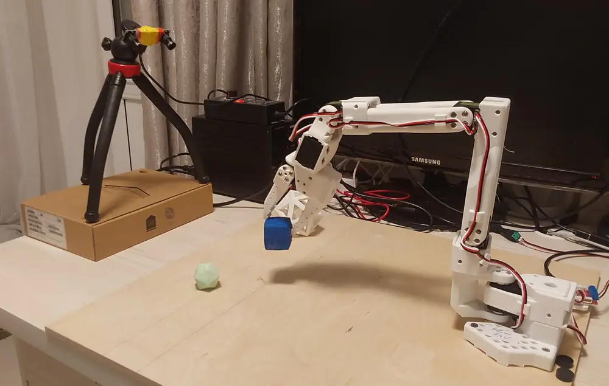

# SO-101 Lab

**Experiments in robotics and Physical AI, starting with the LeRobot SO-101 manipulator.**

{ width="100%" }

*An everyday working setup: the SO-101 follower arm holding a test cube.*

This blog documents my experiments in robotics and Physical AI, beginning with the LeRobot SO-101 manipulator. I am particularly interested in how modern AI methods can be applied to spatial and embodied tasks, and in what can realistically run on modest local hardware.

## Research direction

The technical focus is on large language models (LLMs), vision-language-action (VLA) models, and agentic frameworks for spatial AI tasks. I want to explore multi-step scenarios, interaction with objects and environments, creative problem-solving, and adaptation when conditions or goals change.

## Small models on local hardware

Computational resources are limited, so one recurring question is: **what is the smallest model that can perform a useful task well enough?** I will prioritize compact models that run efficiently on local hardware, with real-time or near-real-time operation wherever practical, rather than assuming that larger models are always necessary.

## Reproducible experiments

Reproducibility is a core goal. I will document the hardware and software used in each experiment—including camera models, placement, and configuration—along with component setup, calibration, versions, settings, and step-by-step protocols. The aim is to make it possible to understand not only the result, but also how to reproduce the setup.

## Simulation-to-real and generalization

Another central theme is transferring trajectories and behaviors developed in simulation to the physical SO-101, then studying where simulation and reality differ. I also want to evaluate how well models and methods handle unseen objects, configurations, and out-of-domain scenarios—not just familiar cases from their training or tuning environments.

-   :material-tools: **Build and configure**

    ---

    3D printing, mechanical assembly, wiring, motor setup, and calibration.

    [:octicons-arrow-right-24: Getting started](getting-started/overview.md)

-   :material-code-braces: **Software and simulation**

    ---

    LeRobot tools, Python utilities, robot descriptions, and PyBullet experiments.

    [:octicons-arrow-right-24: Experiments](experiments/index.md)

-   :material-notebook-edit: **Lab notebook**

    ---

    Dated experiment reports: what was tried, what worked, what failed, and what comes next.

    [:octicons-arrow-right-24: Read the blog](blog/index.md)

## Working principles

- **Reproducibility:** record hardware versions, camera configurations, software versions, settings, and procedures.
- **Measurement over assumption:** distinguish measured results from estimates and hypotheses.
- **Useful failures:** preserve failed experiments and explain what they taught us.
- **Resource awareness:** evaluate capability alongside runtime, memory use, and compute requirements.
