# Сборка SO-101

Всю информацию по сборке, моделям, кодовой базе для SO-101 можно найти в [документации LeRobot по SO-101](https://huggingface.co/docs/lerobot/so101).

Для начала сделаю небольшое пояснение по терминам и названиям, чтобы совсем новичкам (я тоже по сути новичок, но немного вжившийся в тему) было проще вкатиться.

## Термины и названия

*Follower arm* это собственно роборука, которая может двигаться по командам от компьютера, ноутбука, контроллера и т.д.:

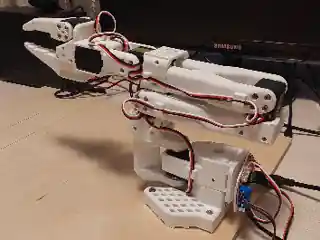

Существует 2 варианта follower arm SO-101, в зависимости от напряжения сервоприводов: 7.4V и 12V. Они полностью идентичны по количеству и размерам деталей, кроме напряжения питания сервоприводов. С практической точки зрения, вариант 12V чуть лучше по энерговооруженности манипулятора, в частности по способности преодолевать силу тяжести. Я сначала собрал вариант на 7.4V, увидел проблему с движениями “вверх” и собрал вторую роборуку на 12V.

Делать эксперименты можно с одной follower arm: для настройки и запуска моделей этого вполне достаточно. Но если возникнет необходимость “показывать” эталонные движения роборуки, например для небольшого обучающего датасета, то без *leader arm* не обойтись. Выглядит эта штука так:  
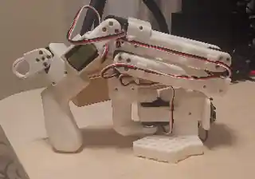

Единственное внешнее отличие: вместо захвата (gripper) у leader arm пистолетная рукоятка. Вы хватаете ее ладонью и двигаете leader arm своей рукой, показывая правильную траекторию. При этом сервоприводы в leader arm работают только как датчики положения, позволяя подключенному через такой же, как у follower arm, интерфейс компьютеру считывать их состояние. Есть и второе, спрятанное уже в спецификациях, отличие по сервоприводам. Они должны быть немного не такие, как для follower по передаточным числам редукторов. Подробнее я скажу об этом ниже при описании сборки.

## Follower Arm 7.4V

Это была первая версия SO-101, которую я собрал. Можно сказать, что первый блин не вышел комом, то есть получилось распечатать детали, заказать и получить электронные компоненты, всё скрутить и запустить.

Итак, какие компоненты нужны?

### Пластиковые детали и 3D-печать

Во-первых, пластиковые детали. Я их напечатал на 3d принтере по готовому бесплатно доступному проекту - его можно найти, например, [на странице проекта на MakerWorld](https://makerworld.com/ru/models/1399268-lerobot-so-101-arms-_-updated). Перед скачиванием проекта рекомендую сделать поиск более актуальной версии, так как время от времени в проект вносятся улучшения.

Для печати я использовал самый дешёвый 3d принтер BambuLab A1 mini, причем брал refab-версию, то есть уцененную из-за внешних дефектов. Распечатка комплекта для follower’а займет целый день, включая паузы на остывание стола между порциями. На этой фотографии запечатлен как раз момент распечатки:

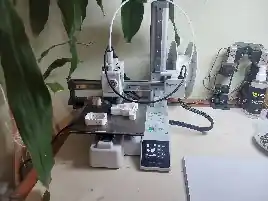

Для печати нужен филамент, то есть пластиковая нить. Я использовал филамент BambuLab PLA basic - в целом особых проблем не было. Катушку (она видна справа) можно купить на маркетплейсах. Чтобы не столкнуться с проблемами качества, я брал “фирменный” филамент под маркой BambuLab. Замечу, что PLA очень прост в использовании, но имеет некоторые недостатки, в частности - хрупкость напечатанных деталей. В какой-то момент при распечатке деталей для второго follower’а я, отламывая подпорки от напечатенной детали, слишком надавил и сломал детальку. Пришлось распечатывать её снова.

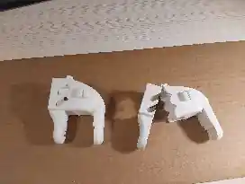

### Электронные компоненты

Далее, нужны электронные компоненты - сервоприводы и плата последовательного интерфейса.

На маркетплейсах можно заказать сразу набор из 6 сервоприводов Feetech STS3215 ST-3215-C001 для follower arm. На что обращать внимание: передаточное число редуктора, для follower оно должно быть 1:345.   
Также учтите, что есть два варианта: 7.4V и 12V. Все моторы одной руки должны быть на одно напряжение.

Для варианта с сервоприводами 7.4V везде пишут, что надо использовать блок питания 5V. Однако такое низкое напряжение еще ухудшает запас энерговооруженности манипулятора. Я повысил напряжение до 7.4V и это немного улучшило динамику, без каких-либо негативных последствий.

Кроме сервоприводов, будет нужна плата для последовательного интерфейса, типа FE-URT-2:  
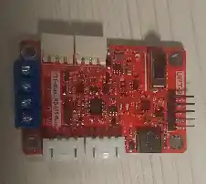

Их много под разными брендами, и вы можете найти совсем не похожую по внешнему виду. Например, у меня есть еще такой форм-фактор:  
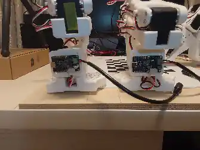

Плату можно купить отдельно на маркетплейсах или в комплекте с 6 сервоприводами - лучше смотреть на итоговую цену. Одна плата может управлять всеми 6 сервоприводами. К компьютеру она подключается через USB, а сервоприводы цепляются цепочкой друг к другу и один подключается к плате.

### Конфигурирование сервоприводов

Сервоприводы для одного манипулятора перед сборкой нужно сконфигурировать: присвоить каждому ID от 1 до 6. Делается это так.

Прежде всего, нужно установить пакет lerobot. На момент написания этого текста последней версией была 0.6.0, поэтому ключевые пакеты в окружении conda у меня такие:

~~~text
lerobot==0.6.0
torch==2.9.1+cu126
transformers==5.5.4
~~~

Версия CUDA 12.3. Не самая свежая, но видеокарта у меня достаточно старая, поэтому драйвер под нее определяет возможные версии CUDA.

Создав и активировав окружение, подключаете плату серийного интерфейса через USB к компьютеру. Затем определяете порт, к которому подключили:

~~~bash
lerobot-find-port
~~~

Для Linux адрес будет выглядеть, например, так: /dev/ttyACM0

Запускается конфигурирование (пример для follower’а):

~~~bash
lerobot-setup-motors --teleop.type=so101_follower --teleop.port=/dev/ttyACM0
~~~

Следуете подсказкам в консоли, подключая поочередно сервоприводы. Каждый сервопривод получит уникальный ID, который определяет, в каком сочленении он будет работать. Я записывал эти отметки на корпусе каждого двигателя, чтобы потом спокойно собирать манипулятор.

Также нужно выставить каждый привод в нейтральное положение. Я для этого использовал простой скрипт [center_servo.py](https://github.com/Koziev/so101-lab/blob/main/software/so101/center_servo.py), запуская его для каждого сервопривода с нужным id:

~~~bash
python center_servo.py --port /dev/ttyACM0 --id 3
~~~

### Механическая сборка

Настроив сервоприводы, можно собирать роборуку. Устанавливать сервоприводы следует в строгом соответствии с их ID:  

Поэтапные видеоинструкции для сборки есть в [документации LeRobot по SO-101](https://huggingface.co/docs/lerobot/so101).

Мой таймлапс процесса сборки:

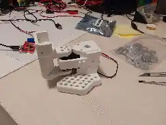
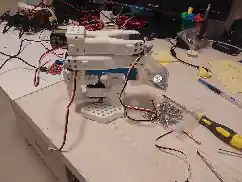
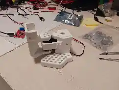

### Калибровка

После сборки манипулятора (или обоих манипуляторов - см. ниже) нужно его спрофилировать - определить границы углов поворота каждого сервопривода. Для follower’а это может выглядеть так:

~~~bash
lerobot-calibrate --robot.type=so101_follower --robot.port=/dev/ttyACM0 --robot.id=my_follower
~~~

Файл с параметрами будет сохранен и далее автоматически загружаться при вызовах команд lerobot.

### Проверка работы сервоприводов

После сборки и подключения можно покрутить сервоприводы с помощью простой GUI утилитки, исходный код которой находится в репозитории: [so101_tk_slider_gui_record_playback.py](https://github.com/Koziev/so101-lab/blob/main/software/so101/so101_tk_slider_gui_record_playback.py). Поправьте в начале кода следующие строки, указав свои параметры:

~~~python
PORT = "/dev/ttyACM0"
ROBOT_ID = "my_follower"
~~~

Затем запустите, и ползунками меняйте состояние сервоприводов:

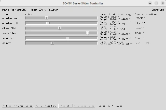

## Leader Arm + Follower Arm 12V

Комплект из leader и follower arms даёт немного больше возможностей, в частности позволяя формировать эталонные траектории движения. При этом оба манипулятора состоят из почти одинакового набора пластиковых деталей, поэтому время распечатки на 3d принтере умножайте на 2.

Далее, для leader arm нужен особый набор сервоприводов с разными передаточными числами редукторов, чтобы сделать работу оператора более комфортной и снизить риск разрушения шестерёнок в редукторах, когда вы прикладываете большое усилие, чтобы раскрутить внутренний двигатель (они понижающие, поэтому усилие снаружи превращается в большие обороты внутри, вынуждая применять силу, чтобы крутить ротор, и это чревато неприятностями).

Если нет желания распечатывать детали, можно заказать на aliexpress или других маркетплейсах готовый комплект с сервоприводами, блоками питания и распечатанными деталями - ищите SO-101 kit, их несколько вариантов. Вам нужен вариант с “3D printed parts included”. Обратите внимание, что вариант “without 3D printed parts” будет иметь зеленую маркировку, а “3D printed parts included” - красную. Это контринтуитивный момент, будьте внимательны. Я заказывал комплект Pro без 3D деталей на aliexpress, примерно через 2 недели получил большую коробку со всем необходимым, включая 2 комплекта сервов для leader и follower’а на 12V.

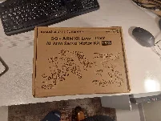

В коробке оказался также симпатичный коврик с логотипом Hugging Face:  
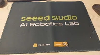

Кстати, я видел рекламу отдельных комплектов распечатанных деталей для SO-101:  
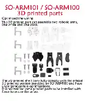
Поэтому вариантов приобретения всего необходимого достаточно много.
